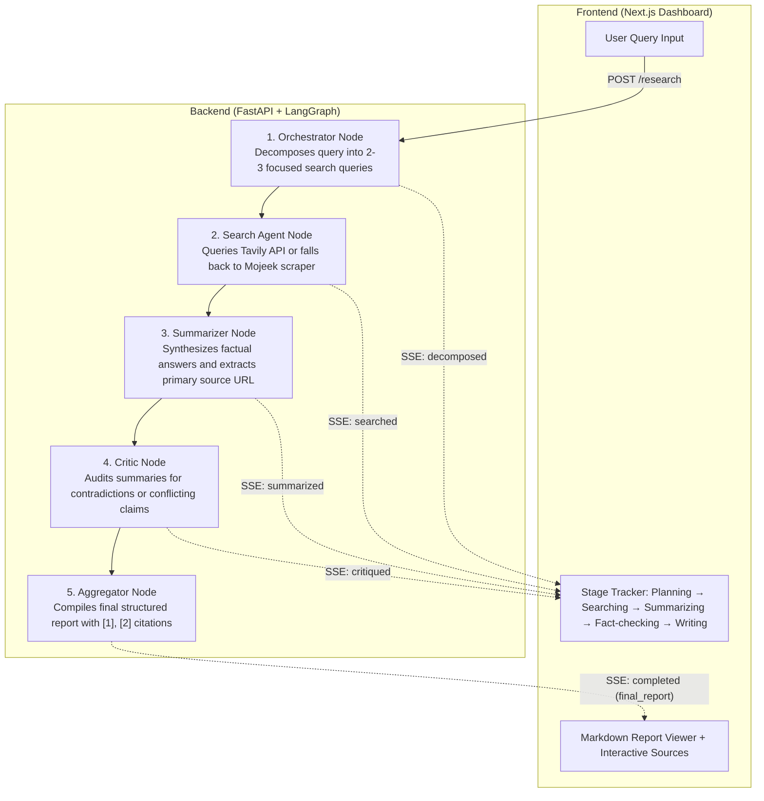

# Multi-Agent Research Assistant

An autonomous AI research assistant that takes a natural language query, decomposes it into focused sub-questions, searches the web, summarizes sources, audits cross-source contradictions, and compiles a structured markdown report with inline citations.

All pipeline stages and the final report are streamed in real time to a Next.js dashboard using Server-Sent Events (SSE).

**Tech Stack:** FastAPI · Next.js · LangGraph · Groq (`llama-3.3-70b-versatile`) · Tavily API · Mojeek Scraper

---

## Architecture & Pipeline

The system uses a sequential 5-node LangGraph state machine. Each node updates the shared `AgentState` and pushes progress updates to the frontend via SSE.



### Node Breakdown

| Node | Powered By | Role | Output in State |
|---|---|---|---|
| **Orchestrator** | Groq (`llama-3.3-70b-versatile`) | Decomposes query into 2–3 sub-questions with clean 3–4 keyword search phrases. | `sub_questions` |
| **Search Agent** | Tavily API / Mojeek scraper | Retrieves top web results and extracts titles, URLs, and snippets. | `scraped_results`, `source_urls` |
| **Summarizer** | Groq (`llama-3.3-70b-versatile`) | Generates a 3–4 sentence factual answer per sub-question with source attribution. | `summaries` |
| **Critic** | Groq (`llama-3.3-70b-versatile`) | Flags contradictions, mismatched statistics, or conflicting perspectives. | `contradictions` |
| **Aggregator** | Groq (`llama-3.3-70b-versatile`) | Synthesizes summaries and critique into a comprehensive cited markdown report. | `final_report` |

---

## Project Structure

```
├── backend/
│   ├── agent_graph.py      # LangGraph state machine: 5 nodes + search fallback logic
│   ├── main.py             # FastAPI server: POST /research endpoint + SSE streaming
│   ├── test_graph.py       # Standalone CLI runner to execute and debug graph from terminal
│   ├── requirements.txt    # Python dependencies
│   ├── .env.example        # Environment variable template
│   └── .env                # Local API credentials (gitignored)
│
├── frontend/
│   ├── src/app/
│   │   ├── page.jsx        # Dashboard UI: SSE consumer, stage tracker, markdown renderer
│   │   ├── layout.jsx      # Metadata and root layout
│   │   └── globals.css     # Dark space design system and animations
│   ├── package.json        # Next.js 16, React 19, Tailwind CSS v4
│   └── next.config.mjs     # Next.js configuration
│
├── run.txt                 # Quick copy-paste startup reference
└── README.md
```

---

## Prerequisites

- **Python 3.10+**
- **Node.js 18.18+** (Node.js 20+ recommended)
- **Groq API Key** (Required) — [Get a free Groq key](https://console.groq.com)
- **Tavily API Key** (Optional) — [Get a Tavily key](https://app.tavily.com). If not provided, search automatically falls back to Mojeek scraping.

---

## Setup & Running

Two separate terminal windows are required: one for the backend and one for the frontend.

### 1. Backend (Terminal 1)

```bash
cd backend

# Create virtual environment (first time only)
python -m venv venv

# Activate virtual environment
# Windows (PowerShell):
.\venv\Scripts\Activate.ps1
# Windows (CMD):
.\venv\Scripts\activate.bat
# macOS / Linux:
source venv/bin/activate

# Install dependencies (first time only)
pip install -r requirements.txt

# Configure environment variables
# Copy .env.example to .env and insert your API keys:
cp .env.example .env
```

Ensure `backend/.env` contains your key(s):
```env
GROQ_API_KEY=your_groq_api_key_here
TAVILY_API_KEY=your_tavily_api_key_here
```

Start the FastAPI backend:
```bash
python main.py
```

- API server: `http://localhost:8000`
- Interactive Swagger docs: `http://localhost:8000/docs`

### 2. Frontend (Terminal 2)

```bash
cd frontend

# Install dependencies (first time only)
npm install

# Start Next.js development server
npm run dev
```

- Dashboard UI: `http://localhost:3000`

---

## CLI Execution & Testing

You can run the full multi-agent research pipeline directly in your terminal without starting the frontend or web server:

```bash
cd backend

# Run with default sample query ("Is caffeine intake good or bad for anxiety and sleep quality?")
python test_graph.py

# Or supply any custom query as an argument:
python test_graph.py "What are the latest breakthroughs in solid-state batteries?"
```

This executes all 5 graph nodes sequentially, printing stream checkpoints, intermediate scraped results, critic findings, and the final compiled report to stdout.

---

## Web Search & Fallback Architecture

The search tool ([`search_web`](backend/agent_graph.py)) is designed for high availability:

1. **Primary: Tavily Search API**
   - If `TAVILY_API_KEY` is set, queries Tavily for clean, AI-optimized search snippets.
2. **Automatic Fallback: Mojeek Scraper**
   - If `TAVILY_API_KEY` is not configured, or if the Tavily API call fails (timeout, rate limit, or network error), the system automatically falls back to scraping [Mojeek](https://www.mojeek.com).
   - The query pre-processor strips 4-digit years from Mojeek fallback queries to bypass temporal rate/WAF rules while preserving relevance.
